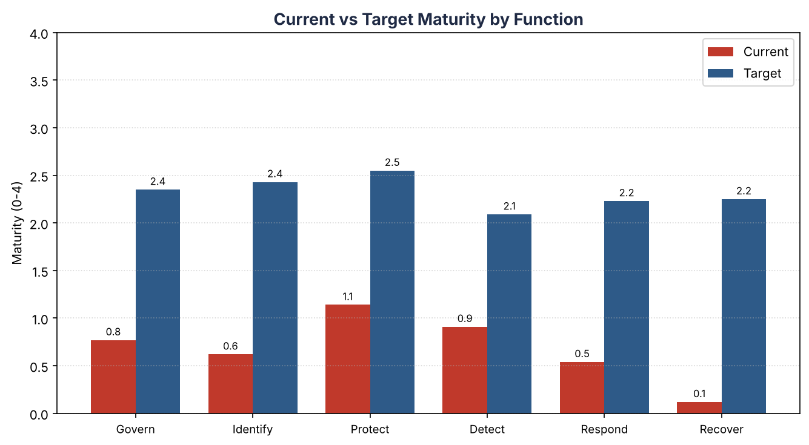
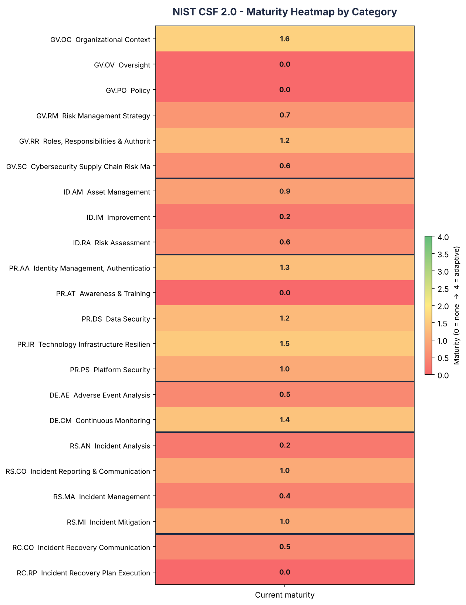

# NIST CSF 2.0 Maturity Assessment

A guided, framework-anchored cybersecurity **maturity assessment** built on the
**NIST Cybersecurity Framework (CSF) 2.0**. It scores an organisation across all
**106 CSF 2.0 subcategories**, turns the scores into a gap analysis and a
function-level dashboard, and auto-generates a **prioritised remediation
roadmap**.

The worked example assesses a real small business — a **homestay / estate-stay
operation** — rather than an invented company, so the scope, assets and risks
are concrete. Swap in your own organisation and the whole thing re-scores.

> **Why this project?** GRC (Governance, Risk & Compliance) work is best learned
> against a real standard and a real-enough scope, not by inventing a fake
> company you have no way to sanity-check. This repo does exactly that: it
> anchors the assessment to NIST CSF 2.0 and a concrete small business, and ships
> a reusable scoring tool so the result is repeatable, not a one-off opinion.

---

## What's inside

| Path | What it is |
|---|---|
| `assessment/CSF2.0_Maturity_Assessment.xlsx` | The assessment workbook: all 106 subcategories, Current/Target scoring, auto Gap + Priority, a Dashboard with charts, and an auto-ranked Roadmap. |
| `tool/csf_data.py` | The CSF 2.0 catalogue (functions, categories, 106 subcategory IDs) + the example scores. One place to edit. |
| `tool/build_workbook.py` | Regenerates the Excel workbook from `csf_data.py`. |
| `tool/score.py` | **Scoring engine.** Reads a completed workbook and produces the heatmap, bar chart, and roadmap (Markdown + CSV). |
| `docs/scope.md` | The scope document for the example assessment. |
| `docs/methodology.md` | How scoring, gaps and priority are calculated. |
| `output/` | Generated artifacts (heatmap, charts, roadmap). |

---

## The results (example scope)

Overall maturity **0.75 / 4**, target **2.36 / 4** — i.e. the business is at ~32%
of a realistic target for its size. Weakest function is **Recover** (0.1/4): no
tested backups and no recovery plan.





| Function | Current | Target | Gap | % to target |
|---|---|---|---|---|
| Govern (GV) | 0.77 | 2.35 | 1.58 | 33% |
| Identify (ID) | 0.62 | 2.43 | 1.81 | 26% |
| Protect (PR) | 1.14 | 2.55 | 1.41 | 45% |
| Detect (DE) | 0.91 | 2.09 | 1.18 | 44% |
| Respond (RS) | 0.54 | 2.23 | 1.69 | 24% |
| Recover (RC) | 0.13 | 2.25 | 2.13 | 6% |

Full roadmap: [`output/roadmap.md`](output/roadmap.md).

---

## How to use it

### 1. Score an assessment by hand (no code)
Open `assessment/CSF2.0_Maturity_Assessment.xlsx`:

1. Fill in the scope on the **Assessment** sheet header.
2. For each of the 106 subcategories, set **Current (0–4)** and **Target (0–4)**
   in the yellow cells.
3. **Gap**, **Priority**, the **Dashboard** and the **Roadmap** update
   automatically.

### 2. Run the scoring tool
```bash
cd tool
pip install -r ../requirements.txt
python score.py --input ../assessment/CSF2.0_Maturity_Assessment.xlsx --outdir ../output
```
This prints a summary and writes `heatmap.png`, `maturity_by_function.png`,
`roadmap.csv` and `roadmap.md`.

### 3. Rebuild the workbook from scratch
Edit the scores in `tool/csf_data.py`, then:
```bash
cd tool
python build_workbook.py
```

---

## The maturity scale (0–4)

Adapted from the CSF Implementation Tiers:

| Score | Tier | Meaning |
|---|---|---|
| 0 | Not implemented | Doesn't exist, or unknown. |
| 1 | Partial | Ad hoc, reactive, undocumented. |
| 2 | Risk Informed | Aware; some practices, applied inconsistently. |
| 3 | Repeatable | Documented, consistent, policy-backed. |
| 4 | Adaptive | Measured with metrics and continuously improved. |

## NIST CSF 2.0 structure

6 Functions → 22 Categories → 106 Subcategories:

- **GV — Govern** (31): strategy, roles, policy, oversight, supply-chain risk
- **ID — Identify** (21): asset management, risk assessment, improvement
- **PR — Protect** (22): identity & access, training, data & platform security, resilience
- **DE — Detect** (11): continuous monitoring, adverse-event analysis
- **RS — Respond** (13): incident management, analysis, reporting, mitigation
- **RC — Recover** (8): recovery execution, recovery communication

---

## Extensions

### 1. NIST CSF 2.0 ↔ ISO/IEC 27001:2022 crosswalk

Maps all 106 CSF 2.0 subcategories to the ISO/IEC 27001:2022 Annex A controls (93)
and ISMS management clauses (4–10), then reports how far a CSF assessment carries
toward ISO 27001 — including the ISO controls a CSF assessment does **not** directly
surface (certification blind spots).

```bash
cd tool
python iso_crosswalk.py          # writes to ../output/
```

Outputs: `crosswalk_report.md`, `crosswalk_csf_to_iso.csv`,
`crosswalk_iso_to_csf.csv`, `iso_coverage.png`. Current result: **68 of 93 Annex A
controls (73%)** are touched by a CSF 2.0 assessment; the strongest ISO-only gaps are
in People and Physical controls.

> The Annex A titles are authoritative (ISO/IEC 27001:2022). The CSF→ISO mapping is a
> **curated, analyst-built crosswalk**, not a verbatim copy of NIST's official
> Informative References — validate against those and ISO/IEC 27002:2022 for
> production use.

### 2 + 3. Evidence Analysis Pipeline (completeness check + AI-assisted analysis)

Scans a folder of evidence (policies, access reviews, logs, inventories), links each
document to the CSF subcategory / ISO 27001 control it supports, and flags every
expected control as **PRESENT / STALE / MISSING** with a completeness score. An
AI layer then drafts a summary, suggested controls, and potential gaps per document —
**always labelled "pending human review"** (human-in-the-loop by design).

```bash
cd tool
python evidence_pipeline.py                 # offline mock AI mode — runs anywhere
# optional real AI mode:
#   pip install anthropic && export ANTHROPIC_API_KEY=sk-...
#   python evidence_pipeline.py --ai-mode real
```

Outputs: `evidence_report.md`, `evidence_matrix.csv`,
`evidence_ai_suggestions.csv` (with a blank `Human_decision` column for sign-off),
and `evidence_completeness.png`. On the bundled sample evidence: **46% completeness,
6 present, 1 stale, 7 missing.**

- **P2 (deterministic):** transparent keyword/filename rules in `evidence_rules.py` —
  auditable, repeatable, no AI.
- **P3 (AI, `ai_analyst.py`):** mock offline heuristic by default; upgrades to the
  Anthropic API when a key is present; every output is decision-support only, never
  an audit finding.

> AI assists analysis; a human control owner is accountable for every conclusion.

---

## Notes

- Subcategory **IDs and structure** follow the official NIST CSF 2.0 Core. The
  one-line outcome descriptions in this repo are **plain-language summaries
  written for the project**, not NIST's official subcategory text.
- NIST CSF is a voluntary framework published by the U.S. National Institute of
  Standards and Technology. This is an independent learning/portfolio project and
  is not affiliated with or endorsed by NIST.

## License
MIT — see `LICENSE`.
