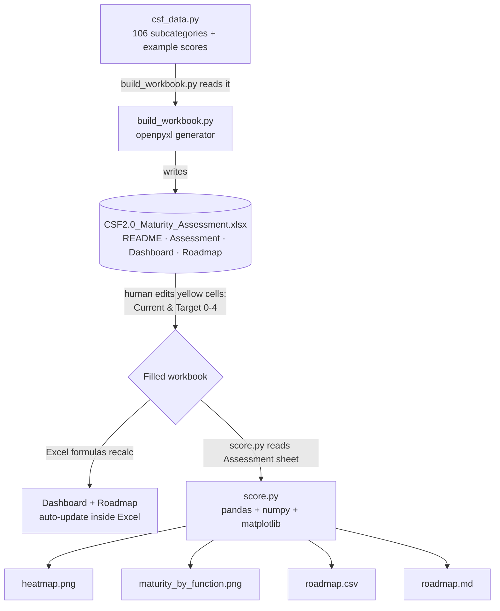

# Deliverable A — Complete Project Reverse-Engineering Report

**Project:** NIST Cybersecurity Framework (CSF) 2.0 — Cybersecurity Maturity Assessment and Prioritised Remediation Roadmap
**Author:** Rithish P K
**Purpose of this document:** To let you understand, explain, and defend every part of the project you built, down to each formula and function.

> **Honesty note on sourcing.** Everything in this report is reconstructed from the actual code and files created in our build session — `csf_data.py`, `build_workbook.py`, `score.py`, the Excel workbook, the README and the two `docs/` files. Where I describe a design choice as "custom," it means *we* invented it for this project and it is **not** an official NIST requirement. I flag those carefully, because an interviewer will test exactly that distinction.

---

## 1. The project in one paragraph (plain English)

You built a **tool that measures how good an organisation's cybersecurity is**, using a well-known government framework (NIST CSF 2.0) as the measuring stick. A person scores the organisation on 106 specific security outcomes — once for "where are we today" and once for "where should we be." The tool then calculates the **gaps**, ranks them so the **most urgent weaknesses come first**, and produces charts, a spreadsheet dashboard, and a to-do list (a "remediation roadmap"). The worked example assesses a small homestay business, but you can drop in any organisation.

**What it is NOT:** it is not an audit, it does not certify anyone, and the example scores are made-up illustrations, not evidence-backed findings. (This matters enormously for interviews — more in Section 7.)

---

## 2. Problem statement, objectives, scope

**Problem.** Most organisations — especially small ones — have no structured way to know how mature their cybersecurity is, which gaps matter most, or what to fix first. They either do nothing or buy expensive consulting. There is no cheap, repeatable, framework-anchored starting point.

**Objective.** Provide a free, repeatable, NIST CSF 2.0-aligned way to (a) score current vs target maturity across all 106 subcategories, (b) quantify the gaps, (c) prioritise them objectively, and (d) output professional artifacts (dashboard, heatmap, roadmap).

**Scope — what's in:**
- A reusable scoring model over the full CSF 2.0 Core (6 functions, 22 categories, 106 subcategories).
- An Excel workbook for manual scoring + auto-calculation.
- A Python engine that reads the workbook and generates charts + a ranked roadmap.
- A worked example (a small hospitality business).

**Scope — what's out (be explicit in interviews):**
- No technical testing (no vulnerability scanning, no penetration testing).
- No real evidence collection (no interviews, no document review).
- No certification, no compliance guarantee.

**Intended users.** A student/analyst learning GRC; a very small business owner wanting a self-assessment; a consultant wanting a lightweight starting template.

---

## 3. Technology stack

| Layer | Technology | Why it's here |
|---|---|---|
| Language | Python 3.12 | Glue + data processing + chart generation |
| Spreadsheet engine | **openpyxl** | Reads/writes `.xlsx` cells, formulas, formatting, charts |
| Data handling | **pandas** | Loads the scores into a table (DataFrame) and groups/aggregates them |
| Numerics | **NumPy** | Vectorised maths (the `np.where` priority step) |
| Charts | **matplotlib** | Renders the heatmap and bar chart as PNG images |
| Office tool | Microsoft Excel / LibreOffice | Opens the workbook; recalculates the formulas |
| Version control | Git + GitHub | Hosts the repo (`github.com/RithishPK/NIST-CSF-Assessment`) |

**Dependencies (from `requirements.txt`):** `openpyxl>=3.1`, `pandas>=2.0`, `matplotlib>=3.7`, `numpy>=1.24`.

---

## 4. Directory structure & file-by-file inventory

```
nist-csf-assessment/
├── README.md                 # Project overview, how-to, results
├── LICENSE                   # MIT licence
├── requirements.txt          # Python dependencies
├── .gitignore                # Excludes __pycache__, temp files
├── assessment/
│   └── CSF2.0_Maturity_Assessment.xlsx   # The workbook (4 sheets)
├── tool/
│   ├── csf_data.py           # The CSF 2.0 catalogue + example scores (the "database")
│   ├── build_workbook.py     # Generates the Excel workbook from csf_data.py
│   └── score.py              # Reads a filled workbook → charts + roadmap
├── docs/
│   ├── scope.md              # Scope document for the example assessment
│   └── methodology.md        # How scoring/gap/priority are calculated
└── output/
    ├── heatmap.png           # Category maturity heatmap
    ├── maturity_by_function.png  # Current vs target bar chart
    ├── roadmap.csv           # Ranked gaps (machine-readable)
    └── roadmap.md            # Ranked gaps (human-readable)
```

### File-by-file explanation

| File | What it is | Why it exists | What it does | Interview-relevant point |
|---|---|---|---|---|
| `csf_data.py` | A pure-data module | Single source of truth for the framework + scores | Holds `FUNCTIONS` (6), `CATEGORIES` (22), `SUBCATEGORIES` (106 rows: id, description, current, target, note), `TIER_LABELS` (0–4), `ORG` (example metadata). Has a self-check asserting the count is 106 with the right split (31/21/22/11/13/8) | Separating data from logic is good engineering. The subcategory **IDs** are official NIST; the **descriptions** are your own plain-language summaries |
| `build_workbook.py` | A generator script | So the workbook can be rebuilt reproducibly from the data | Uses openpyxl to create 4 sheets, write formulas, apply data validation + conditional formatting, and embed two native Excel charts | Shows you can automate document production, not just hand-edit a spreadsheet |
| `score.py` | The analysis engine (the "real code") | To turn raw scores into insight + artifacts | Reads the Assessment sheet, builds a pandas DataFrame, computes gap/weight/priority, aggregates by function, and writes heatmap.png, bar chart, roadmap.csv, roadmap.md | This is your strongest talking point — it's the part with genuine data-processing logic |
| `CSF2.0_Maturity_Assessment.xlsx` | The deliverable workbook | The human interface for scoring | 4 sheets (README, Assessment, Dashboard, Roadmap); 290 formulas; the user edits yellow cells only | Lets a non-coder use the model |
| `README.md` | Repo front page | Orientation + results | Explains the project, usage, and shows the headline numbers | First thing a recruiter sees |
| `docs/scope.md` | Scope document | Mirrors what a real engagement produces | Defines the example org, assets, data types, obligations, threats, target rationale | Evidence you understand *scoping*, a real GRC step |
| `docs/methodology.md` | Methods note | Documents the maths + its limits | Defines the 0–4 scale, gap, priority weight, and admits the limitations | Shows intellectual honesty |

**Implemented vs proposed — be precise:**
- **Actually implemented:** everything in the table above. The workbook, the scoring engine, the charts, the roadmap, the example.
- **Mentioned in docs but not "features":** the India DPDP Act reference in `scope.md` is *context*, not something the tool checks.
- **Assumed in the example:** every Current/Target score for Dreams Home Estate Stay is an **illustrative assumption**, not a measured finding.
- **Proposed but never built (future work):** ISO 27001 ISMS artifacts, a NIST↔ISO↔CIS crosswalk tool, any real evidence capture, any multi-organisation support.

---

## 5. System architecture & data flow

**Plain English:** the data file feeds the workbook builder, which produces the Excel file. A human fills in scores. The scoring engine reads those scores back and produces the charts and roadmap. Python and Excel do **not** talk live — they connect only through the `.xlsx` file sitting on disk.



**The key architectural idea:** there are **two independent scoring paths** that must agree —
1. the **Excel formulas** (for someone who never runs Python), and
2. the **Python engine** (for charts + a clean roadmap).

Both implement the same gap and priority logic. (Section 8 shows where they subtly *disagree* — a real bug.)

---

## 6. The Excel workbook — complete walkthrough

### 6.1 Sheet: README
Static. Explains the 0–4 scale, the usage steps, and that only yellow cells are edited. No formulas.

### 6.2 Sheet: Assessment (the core)
106 rows (rows 9–114). Columns:

| Col | Header | Content | Type |
|---|---|---|---|
| A | (function tag) | `GV`/`ID`/… | label, used by Dashboard |
| B | ID | `GV.PO-01` etc. | official NIST id |
| C | Category | e.g. "Policy" | label |
| D | Outcome | plain-language description | your text |
| E | **Current (0–4)** | user input | **yellow, editable** |
| F | **Target (0–4)** | user input | **yellow, editable** |
| G | Gap | `=MAX(0, F−E)` | formula |
| H | Priority | nested IF (below) | formula |
| I | Evidence/notes | free text | your text |

**Data validation:** E and F only accept whole numbers 0–4 (an error pops up otherwise). This stops someone typing "5" or "high."

**Conditional formatting:**
- Column E: a 3-colour scale (red at 0 → yellow at 2 → green at 4) — the heatmap effect.
- Column H: red fill for "High", amber for "Medium", green for "Low".

**The Gap formula:**
```
=MAX(0, F−E)
```
`MAX(0, …)` clamps at zero so that if someone already *exceeds* the target, the gap shows 0 rather than a negative number. Example: Current 1, Target 3 → Gap 2. Current 3, Target 2 → Gap 0 (not −1).

**The Priority formula (the clever bit):**
```
=IF(G=0,"-",
   IF((G+(4−E)/2)>=3.5,"High",
      IF((G+(4−E)/2)>=2,"Medium","Low")))
```
It computes a **priority weight** = `Gap + (4 − Current)/2`, then bands it. The `(4 − Current)/2` term means a control sitting at **0** gets a +2 boost, so *missing* controls rise above merely *weak* ones even when the raw gap is the same.

Worked examples:
- `GV.PO-01`: Current 0, Target 3 → Gap 3, weight = 3 + (4−0)/2 = **5** → High.
- `GV.RM-02`: Current 0, Target 2 → Gap 2, weight = 2 + 2 = **4** → High.
- `GV.OC-01`: Current 2, Target 3 → Gap 1, weight = 1 + (4−2)/2 = **2** → Medium.
- A mature-ish gap, Current 3, Target 4 → Gap 1, weight = 1 + 0.5 = **1.5** → Low.

### 6.3 Sheet: Dashboard
For each of the 6 functions it computes, using the function tag in column A of the Assessment sheet:
```
Avg Current = AVERAGEIF(Assessment!$A$9:$A$114, <func>, Assessment!$E$9:$E$114)
```
…and likewise Avg Target, Avg Gap, and `% to target = Current ÷ Target`. An **OVERALL** row uses plain `AVERAGE` over all 106. Two native Excel charts are embedded: a **column chart** (current vs target per function) and a **radar chart** (profile shape).

**What "AVERAGEIF" does:** average the numbers in one range, but only for rows where another range matches a condition. Here: "average the Current scores, but only the rows tagged `GV`."

### 6.4 Sheet: Roadmap
The top 25 highest-weight gaps, ranked in Python at build time, each row **linking back** to the Assessment sheet (`=Assessment!G20` etc.) so Gap/Priority stay live. Blank yellow columns for **Owner / Effort (S/M/L) / Target date** — turning the assessment into an action plan.

---

## 7. The Python engine (`score.py`) — technical walkthrough

### 7.1 What it imports and why
- `openpyxl` — to open the `.xlsx` and read cached cell values (`data_only=True`).
- `pandas` — to hold the 106 rows as a DataFrame and group them by function.
- `numpy` — for the vectorised `np.where` used in the priority step.
- `matplotlib` (with the non-interactive `Agg` backend, so it works on a server with no screen) — to draw PNGs.
- `argparse` / `os` — command-line options and file paths.

### 7.2 The pipeline (functions, in order)

1. **`read_assessment(path)`** — opens the workbook, finds the header row by locating the cell that says "ID", then walks every row with a valid subcategory id and pulls Current/Target. Returns a tidy DataFrame with `id, function, category, outcome, current, target, gap`.
   - *Why read `data_only=True`?* openpyxl can return either the **formula text** or the **last cached value**. For analysis you want the values, so the workbook must have been opened+saved by Excel/LibreOffice at least once (which is why the build step runs a recalculation).

2. **Priority classification** (inside `read_assessment`):
   ```python
   df["weight"] = df["gap"] + (4 - df["current"]) / 2
   df["priority"] = pd.cut(
       np.where(df["gap"] == 0, -1, df["weight"]),
       bins=[-2, 0, 2, 3.5, 99],
       labels=["None", "Low", "Medium", "High"])
   ```
   `np.where(gap==0, -1, weight)` sets a sentinel of −1 for zero-gap rows so they land in the "None" band; everything else is binned by weight. This mirrors the Excel IF-ladder (with one boundary difference — see Section 8).

3. **`summarise(df)`** — `groupby("function")` then `.mean()` of current/target/gap, plus `% to target`. This is the Dashboard, computed in Python.

4. **`heatmap(df, outdir)`** — averages each **category** and draws a single-column matplotlib image, red→green, with black separator lines between functions.

5. **`bar_chart(summary, outdir)`** — grouped bars, Current (red) vs Target (blue), per function.

6. **`roadmap(df, summary, outdir, top_n=25)`** — filters to `gap>0`, sorts by weight then gap, writes `roadmap.csv` and a formatted `roadmap.md`.

7. **`main()`** — wires it together with an `argparse` CLI (`--input`, `--outdir`, `--top`) and prints a console summary.

### 7.3 Running & debugging on your Windows 11 + VS Code
- Open the repo folder in VS Code, open a terminal (`` Ctrl+` ``).
- `pip install -r requirements.txt` once.
- `cd tool` then `python score.py`.
- To debug: set a breakpoint in VS Code on the `df["weight"] = …` line, press F5, and inspect `df` in the Variables pane — you'll literally see the 106-row table.
- Common error: `ModuleNotFoundError` → the install hit a different Python; run `python -m pip install -r requirements.txt`.

---

## 8. Critical audit (Part 8) — a senior consultant's honest review

I am being deliberately strict here, because these are the things a Big 4 interviewer will probe, and knowing them *before* they ask is what separates you from someone who just ran an AI tool.

### 8.1 Methodology issues (important)

**(a) NIST CSF 2.0 does not define a 0–4 per-subcategory "maturity score." — This is the single most important thing to understand.**
- *What's wrong:* The project scores each of the 106 subcategories on a 0–4 scale and calls it "maturity." Official CSF 2.0 does **not** work that way. CSF has **Tiers 1–4** (Partial, Risk Informed, Repeatable, Adaptive), and those Tiers describe *how rigorous the organisation's overall cyber-risk governance and management is* — they are applied holistically with **Profiles** (a Current Profile and a Target Profile), not as a score stamped on each subcategory.
- *Why it matters:* If you say "NIST tells you to score each subcategory 0–4," a knowledgeable interviewer will correct you. If **you** volunteer "I adapted the CSF Implementation Tiers into a 0–4 per-subcategory maturity scale — that's a common consulting practice, not an official NIST method," you sound like you understand the framework.
- *Impact:* illustrative only; fine for a learning tool, wrong to present as the official method.
- *Fix / honest framing:* keep the model, but label it clearly as a **custom maturity overlay inspired by the CSF Tiers and CMMI-style maturity models**. The Current/Target idea genuinely does mirror CSF's **Current Profile vs Target Profile** — lean on that, it's the legitimate CSF concept your model maps to.

**(b) Simple averages treat all 106 outcomes as equally important.**
- *What's wrong:* `AVERAGEIF`/`.mean()` give "map your network data flows" the same weight as "test your backups." In reality some controls are far more critical.
- *Impact:* a function's average can look healthier or worse than its real risk.
- *Fix:* add a per-subcategory criticality weight and use a weighted average. (Optional for a beginner project, but name it as a known limitation.)

**(c) The priority weight `Gap + (4 − Current)/2` is entirely custom.**
- It is reasonable and defensible (it pushes absent controls up), but it is **not** an industry-standard formula. Don't imply it is. Real prioritisation also factors **likelihood × business impact**, not just the maturity gap.

### 8.2 A genuine bug: Excel and Python disagree at the band boundaries

This is real and worth knowing cold.
- **Excel** bands with `>=`: weight **≥ 2** is "Medium", weight **≥ 3.5** is "High".
- **Python** uses `pd.cut(bins=[-2,0,2,3.5,99])`, which is **right-closed**: a weight of **exactly 2.0** falls in the `(0, 2]` bucket = **Low**, and exactly **3.5** falls in `(2, 3.5]` = **Medium**.
- **Consequence:** a subcategory with weight exactly 2.0 (e.g. Current 2, Target 3 → gap 1, weight 2.0, like `GV.OC-01`) is labelled **Medium by the Excel sheet but Low by the Python roadmap**. The two outputs can disagree on boundary rows.
- *Fix:* make the thresholds identical — e.g. in Python use `bins=[-0.1, 0, 1.9, 3.4, 99]` or switch Excel to `>` instead of `>=`, so both agree. A one-line fix, but a great thing to mention: *"I found and can fix an off-by-boundary inconsistency between my two implementations."* That's exactly the kind of self-review auditors value.

### 8.3 Evidence & real-world gaps (by design, but must be stated)
- **No evidence backing any score.** The Dreams Home Estate Stay numbers are assumptions I wrote to make the example concrete — not findings from interviews or document review. **Never present them as a real audit result.**
- **No risk register** in the formal sense (asset → threat → likelihood → impact → treatment). The roadmap is gap-driven, not risk-driven.
- **No control ownership or remediation tracking** beyond blank columns to fill in.
- **No reassessment / trend tracking** over time.

### 8.4 Terminology to correct in how you talk about it
- Say **"self-assessment"** or **"maturity assessment template,"** never "audit."
- Say **"illustrative example,"** never "client" or "engagement."
- Say the tool **"supports prioritisation,"** not "determines risk."

### 8.5 What the project legitimately demonstrates (the positive, stated fairly)
- You can structure a problem around a recognised framework (all 106 subcategories, correctly enumerated — including correctly skipping the non-existent `ID.AM-06`).
- You can separate data from logic, automate document generation, and process data with pandas/numpy/matplotlib.
- You understand Current vs Target profiling and gap-based prioritisation at a conceptual level.
- You documented scope, methodology, and **limitations** — intellectual honesty that senior reviewers respect.

---

## 9. What you should be able to say after reading this

1. "It's a NIST CSF 2.0 maturity **self-assessment** tool — not an audit — that scores 106 subcategories current vs target, computes gaps, and ranks remediation."
2. "The 0–4 scale is my **custom overlay** adapted from the CSF Tiers; the Current/Target idea maps to CSF's Current Profile vs Target Profile."
3. "There are two scoring paths — Excel formulas and a Python engine — and I know they differ at one band boundary, which I can fix."
4. "The example scores are illustrative assumptions, not evidence-backed findings."
5. "Priority = gap boosted when the current score is low; it's defensible but custom, and real prioritisation would add likelihood × impact."

If you can say those five things unprompted, you're already ahead of most freshers presenting an AI-assisted project.

---

*End of Deliverable A. Deliverable B (GRC + NIST CSF 2.0 study guide) follows next.*
