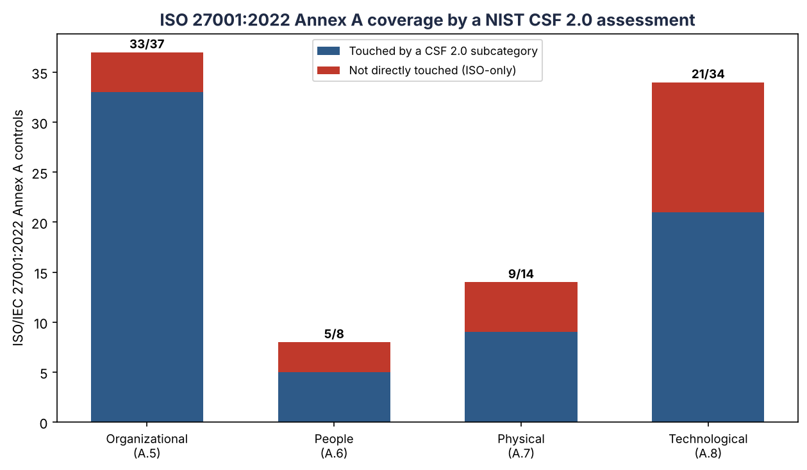

# NIST CSF 2.0 ↔ ISO/IEC 27001:2022 Framework Crosswalk

A mapping between the 106 NIST CSF 2.0 subcategories and the ISO/IEC 27001:2022 Annex A controls (93) plus ISMS management clauses (4–10).

> **Sourcing & honesty.** The Annex A control titles are authoritative (ISO/IEC 27001:2022). The CSF→ISO *mapping* is a **curated, analyst-built crosswalk**, not a verbatim copy of NIST’s official Informative References. Framework mappings are many-to-many and involve judgement; validate against NIST’s official CSF 2.0 Informative References and ISO/IEC 27002:2022 before any certification use.

## Coverage summary

- CSF subcategories mapped: **106 / 106**
- Total CSF→ISO mapping links: **225**
- ISO Annex A controls touched by a CSF assessment: **68 / 93** (73%)
- ISO Annex A controls **not** directly surfaced by CSF: **25**

| ISO theme | Covered | Total | % |
|---|---|---|---|
| Organizational | 33 | 37 | 89% |
| People | 5 | 8 | 62% |
| Physical | 9 | 14 | 64% |
| Technological | 21 | 34 | 62% |

## Interpretation (the GRC insight)

A completed NIST CSF 2.0 assessment gives an organisation a **running start toward ISO/IEC 27001:2022**: the mapped Annex A controls are already understood. The controls listed as *not directly surfaced* below are ISO’s **blind spots relative to CSF** — typically HR/people controls, physical specifics, and documentation items — which an organisation pursuing certification must pick up separately (chiefly via the ISO management clauses 4–10 and the Statement of Applicability).

### ISO Annex A controls NOT directly surfaced by a CSF 2.0 assessment

| ISO ref | Theme | Control |
|---|---|---|
| A.5.8 | Organizational | Information security in project management |
| A.5.10 | Organizational | Acceptable use of information and other associated assets |
| A.5.32 | Organizational | Intellectual property rights |
| A.5.37 | Organizational | Documented operating procedures |
| A.6.4 | People | Disciplinary process |
| A.6.6 | People | Confidentiality or non-disclosure agreements |
| A.6.7 | People | Remote working |
| A.7.6 | Physical | Working in secure areas |
| A.7.8 | Physical | Equipment siting and protection |
| A.7.9 | Physical | Security of assets off-premises |
| A.7.10 | Physical | Storage media |
| A.7.12 | Physical | Cabling security |
| A.8.4 | Technological | Access to source code |
| A.8.11 | Technological | Data masking |
| A.8.17 | Technological | Clock synchronization |
| A.8.18 | Technological | Use of privileged utility programs |
| A.8.21 | Technological | Security of network services |
| A.8.23 | Technological | Web filtering |
| A.8.26 | Technological | Application security requirements |
| A.8.27 | Technological | Secure system architecture and engineering principles |
| A.8.29 | Technological | Security testing in development and acceptance |
| A.8.31 | Technological | Separation of development, test and production environments |
| A.8.32 | Technological | Change management |
| A.8.33 | Technological | Test information |
| A.8.34 | Technological | Protection of information systems during audit testing |

## Forward crosswalk — CSF 2.0 → ISO/IEC 27001:2022

### Govern

| CSF ID | CSF outcome | ISO/IEC 27001:2022 refs |
|---|---|---|
| GV.OC-01 | The organisation's mission is clear and used to prioritise cyber risk | Cl.4, A.5.31 |
| GV.OC-02 | Stakeholder needs/expectations around security are understood | Cl.4, A.5.31 |
| GV.OC-03 | Legal, regulatory and contractual obligations (incl. privacy) are understood | A.5.31, A.5.34, Cl.4 |
| GV.OC-04 | Critical services stakeholders depend on are understood and communicated | Cl.4, A.5.31 |
| GV.OC-05 | Services the org itself depends on are understood | A.5.19, A.5.21, Cl.4 |
| GV.RM-01 | Risk management objectives are agreed by stakeholders | Cl.6, A.5.4 |
| GV.RM-02 | Risk appetite and tolerance statements exist | Cl.6, A.5.4 |
| GV.RM-03 | Cyber risk is part of overall enterprise risk management | Cl.6, A.5.4 |
| GV.RM-04 | Strategic direction for risk response is set and communicated | Cl.6, A.5.4 |
| GV.RM-05 | Communication lines for risk (incl. suppliers) are established | Cl.6, A.5.4 |
| GV.RM-06 | A standard method to calculate and prioritise risk exists | Cl.6, A.5.4 |
| GV.RM-07 | Strategic opportunities (positive risk) are considered | Cl.6, A.5.4 |
| GV.RR-01 | Leadership is accountable for cyber risk and sets the culture | A.5.2, A.5.3, A.5.4, Cl.5 |
| GV.RR-02 | Security roles and authorities are defined and enforced | A.5.2, Cl.5 |
| GV.RR-03 | Resources are allocated to match the risk strategy | A.5.2, A.5.3, A.5.4, Cl.5 |
| GV.RR-04 | Security is built into HR practices | A.6.1, A.6.2, A.6.5 |
| GV.PO-01 | A cybersecurity policy is established and communicated | A.5.1, Cl.5 |
| GV.PO-02 | The policy is reviewed and updated over time | A.5.1, Cl.9, Cl.10 |
| GV.OV-01 | Risk strategy outcomes are reviewed to adjust direction | Cl.9, A.5.35, A.5.36 |
| GV.OV-02 | The strategy is reviewed for adequate coverage | Cl.9, A.5.35, A.5.36 |
| GV.OV-03 | Security performance is measured and reviewed | Cl.9, A.5.35, A.5.36 |
| GV.SC-01 | A supply-chain risk management program exists | A.5.19, A.5.20, A.5.21, A.5.22, A.5.23 |
| GV.SC-02 | Supplier security roles are established and coordinated | A.5.19, A.5.20, A.5.21, A.5.22, A.5.23 |
| GV.SC-03 | Supply-chain risk is integrated into overall risk management | A.5.19, A.5.20, A.5.21, A.5.22, A.5.23 |
| GV.SC-04 | Suppliers are known and prioritised by criticality | A.5.19, A.5.9 |
| GV.SC-05 | Security requirements are written into supplier contracts | A.5.20 |
| GV.SC-06 | Due diligence is done before engaging suppliers | A.5.19, A.5.21 |
| GV.SC-07 | Supplier risk is tracked over the relationship | A.5.22 |
| GV.SC-08 | Suppliers are included in incident/recovery planning | A.5.19, A.5.20, A.5.21, A.5.22, A.5.23 |
| GV.SC-09 | Supply-chain security is monitored across the lifecycle | A.5.19, A.5.20, A.5.21, A.5.22, A.5.23 |
| GV.SC-10 | Plans cover end-of-relationship (offboarding) with suppliers | A.5.22, A.6.5 |

### Identify

| CSF ID | CSF outcome | ISO/IEC 27001:2022 refs |
|---|---|---|
| ID.AM-01 | Hardware inventory is maintained | A.5.9, A.8.1 |
| ID.AM-02 | Software, services and systems inventory is maintained | A.5.9 |
| ID.AM-03 | Authorised network/data flows are mapped | A.5.9, A.8.20 |
| ID.AM-04 | Services provided by suppliers are inventoried | A.5.9, A.5.19 |
| ID.AM-05 | Assets are prioritised by criticality/impact | A.5.9, A.5.12 |
| ID.AM-07 | Data and metadata inventories exist for key data types | A.5.12, A.5.13 |
| ID.AM-08 | Assets are managed across their whole life cycle | A.5.11, A.7.14, A.8.10 |
| ID.RA-01 | Vulnerabilities in assets are identified and recorded | A.8.8, Cl.6 |
| ID.RA-02 | Threat intelligence is received from outside sources | A.5.7 |
| ID.RA-03 | Internal and external threats are identified and recorded | Cl.6, A.5.7, A.8.8 |
| ID.RA-04 | Business impacts and likelihoods are identified | Cl.6, A.5.7, A.8.8 |
| ID.RA-05 | Threats+vulns+impact are combined to prioritise risk | Cl.6 |
| ID.RA-06 | Risk responses are chosen, planned and tracked | Cl.6 |
| ID.RA-07 | Changes and exceptions are risk-assessed and tracked | Cl.6, A.5.7, A.8.8 |
| ID.RA-08 | A process exists to handle vulnerability disclosures | A.8.8, A.5.6 |
| ID.RA-09 | Hardware/software integrity is checked before use | A.5.21, A.8.30 |
| ID.RA-10 | Critical suppliers are assessed before acquisition | Cl.6, A.5.7, A.8.8 |
| ID.IM-01 | Improvements are identified from evaluations | Cl.10, A.5.27 |
| ID.IM-02 | Improvements come from tests and exercises | Cl.10, A.5.27 |
| ID.IM-03 | Improvements come from day-to-day operations | Cl.10, A.5.27 |
| ID.IM-04 | Incident response and continuity plans exist and improve | Cl.10, A.5.27 |

### Protect

| CSF ID | CSF outcome | ISO/IEC 27001:2022 refs |
|---|---|---|
| PR.AA-01 | Identities and credentials are managed | A.5.16, A.5.17 |
| PR.AA-02 | Identities are proofed and bound to credentials | A.5.16 |
| PR.AA-03 | Users, processes and hardware are authenticated | A.8.5, A.5.17 |
| PR.AA-04 | Identity assertions (tokens/sessions) are protected | A.5.15, A.5.16, A.5.17, A.5.18 |
| PR.AA-05 | Access follows least privilege and separation of duties | A.5.15, A.5.18, A.8.2, A.8.3 |
| PR.AA-06 | Physical access to assets is managed and monitored | A.7.1, A.7.2, A.7.3 |
| PR.AT-01 | Staff get general security awareness training | A.6.3 |
| PR.AT-02 | People in specialised roles get role-specific training | A.6.3 |
| PR.DS-01 | Data at rest is protected (confidentiality/integrity/availability) | A.8.24, A.5.33 |
| PR.DS-02 | Data in transit is protected | A.5.14, A.8.24 |
| PR.DS-10 | Data in use is protected | A.7.7, A.8.12 |
| PR.DS-11 | Backups are performed, protected and tested | A.8.13 |
| PR.PS-01 | Configuration management is applied | A.8.9 |
| PR.PS-02 | Software is patched/replaced based on risk | A.8.8, A.8.19 |
| PR.PS-03 | Hardware is maintained/replaced based on risk | A.7.13 |
| PR.PS-04 | Logs are generated and available for monitoring | A.8.15 |
| PR.PS-05 | Unauthorised software is prevented from running | A.8.19, A.8.7 |
| PR.PS-06 | Secure software development practices are used | A.8.25, A.8.28 |
| PR.IR-01 | Networks are protected from unauthorised access | A.8.20, A.8.22 |
| PR.IR-02 | Assets are protected from environmental threats | A.7.5, A.7.11 |
| PR.IR-03 | Resilience mechanisms are built in for adverse conditions | A.8.14 |
| PR.IR-04 | Enough capacity is maintained for availability | A.8.6 |

### Detect

| CSF ID | CSF outcome | ISO/IEC 27001:2022 refs |
|---|---|---|
| DE.CM-01 | Networks are monitored for adverse events | A.8.16, A.8.20 |
| DE.CM-02 | The physical environment is monitored | A.7.4 |
| DE.CM-03 | Personnel activity and tech usage are monitored | A.8.16, A.8.15 |
| DE.CM-06 | External provider activity is monitored | A.5.22, A.8.16 |
| DE.CM-09 | Computing hardware/software and data are monitored | A.8.16, A.8.7 |
| DE.AE-02 | Potentially adverse events are analysed | A.5.25, A.8.16 |
| DE.AE-03 | Information is correlated from multiple sources | A.5.25, A.8.16 |
| DE.AE-04 | Impact and scope of events are understood | A.5.25, A.8.16 |
| DE.AE-06 | Event info is shared with the right people/tools | A.5.25, A.8.16 |
| DE.AE-07 | Threat intel is integrated into analysis | A.5.7 |
| DE.AE-08 | Incidents are declared when criteria are met | A.5.25 |

### Respond

| CSF ID | CSF outcome | ISO/IEC 27001:2022 refs |
|---|---|---|
| RS.MA-01 | The incident response plan is executed on declaration | A.5.24, A.5.26 |
| RS.MA-02 | Incident reports are triaged and validated | A.5.25 |
| RS.MA-03 | Incidents are categorised and prioritised | A.5.24, A.5.26 |
| RS.MA-04 | Incidents are escalated as needed | A.5.24, A.5.26 |
| RS.MA-05 | Criteria for starting recovery are applied | A.5.24, A.5.26 |
| RS.AN-03 | Root-cause analysis is performed | A.5.27 |
| RS.AN-06 | Investigation actions are recorded with integrity | A.5.28 |
| RS.AN-07 | Incident data and evidence are preserved | A.5.28 |
| RS.AN-08 | Incident magnitude is estimated and validated | A.5.25, A.5.28 |
| RS.CO-02 | Stakeholders are notified of incidents | A.5.5, A.6.8 |
| RS.CO-03 | Information is shared with the right stakeholders | A.6.8 |
| RS.MI-01 | Incidents are contained | A.5.26 |
| RS.MI-02 | Incidents are eradicated | A.5.26 |

### Recover

| CSF ID | CSF outcome | ISO/IEC 27001:2022 refs |
|---|---|---|
| RC.RP-01 | The recovery plan is executed when triggered | A.5.29, A.5.30 |
| RC.RP-02 | Recovery actions are selected, scoped and performed | A.5.29, A.5.30, A.8.13 |
| RC.RP-03 | Backup integrity is verified before restoring | A.8.13 |
| RC.RP-04 | Post-incident operating norms are set | A.5.29, A.5.30, A.8.13 |
| RC.RP-05 | Restored systems are verified and confirmed normal | A.5.29, A.5.30, A.8.13 |
| RC.RP-06 | End of recovery is declared and documented | A.5.29, A.5.30, A.8.13 |
| RC.CO-03 | Recovery progress is communicated to stakeholders | A.5.6 |
| RC.CO-04 | Public recovery updates use approved messaging | A.5.5, A.5.6 |

