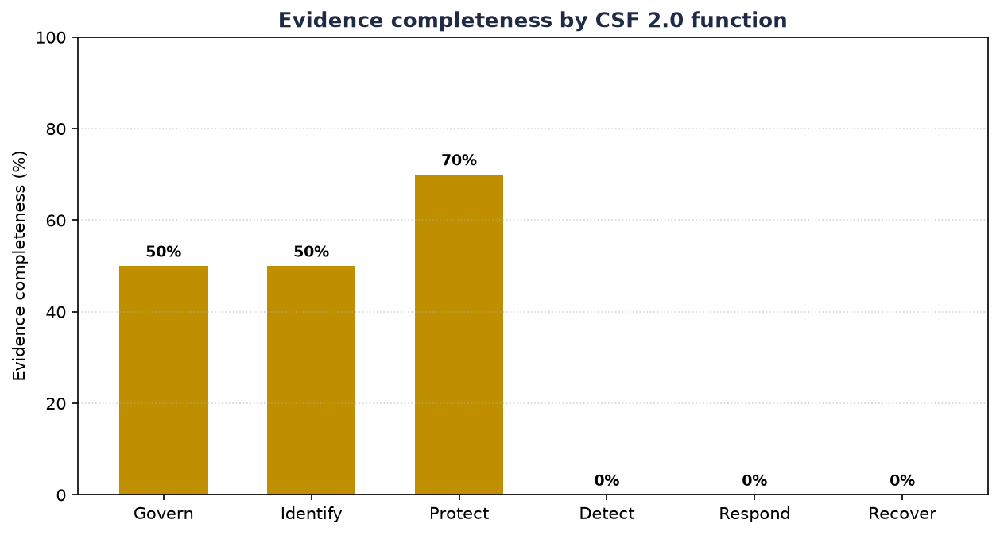

# Evidence Analysis Report

Assessment date: **2026-11-10**  |  Evidence files scanned: **6**  |  Controls checked: **14**  |  AI mode: **mock**

> **How to read this.** The completeness check (present/stale/missing) is deterministic and auditable. The AI section is **decision-support only** — every suggestion is labelled *pending human review*, and a control owner must confirm it before it becomes a finding.

## 1. Completeness summary (deterministic)

- Overall evidence completeness: **46%**
- PRESENT: **6**  |  STALE: **1**  |  MISSING: **7**  (of 14)

| CSF function | Complete % | Present | Stale | Missing |
|---|---|---|---|---|
| Govern | 50% | 2 | 0 | 2 |
| Identify | 50% | 1 | 0 | 1 |
| Protect | 70% | 3 | 1 | 1 |
| Detect | 0% | 0 | 0 | 1 |
| Respond | 0% | 0 | 0 | 1 |
| Recover | 0% | 0 | 0 | 1 |

## 2. Control-by-control evidence matrix

| CSF | ISO | Evidence expected | Status | Newest | Matched files |
|---|---|---|---|---|---|
| GV.RM-06 | Cl.6 | Documented risk assessment method / risk register | **MISSING** | — | — |
| GV.SC-06 | A.5.19, A.5.20 | Supplier / third-party security assessment | **MISSING** | — | — |
| ID.RA-05 | Cl.6 | Risk assessment combining threats/vulns/impact | **MISSING** | — | — |
| PR.PS-02 | A.8.8 | Patch / vulnerability management records | **MISSING** | — | — |
| DE.CM-01 | A.8.16, A.8.15 | Monitoring / logging of systems | **MISSING** | — | — |
| RS.MA-01 | A.5.24, A.5.26 | Incident response plan exists | **MISSING** | — | — |
| RC.RP-01 | A.5.29, A.5.30 | Recovery / business-continuity plan | **MISSING** | — | — |
| PR.DS-11 | A.8.13 | Backups performed AND restore-tested | **STALE** | 2026-02-10 | backup_test_log.md |
| GV.PO-01 | A.5.1 | Information security policy exists & is approved | **PRESENT** | 2026-10-15 | information_security_policy.md |
| GV.RR-02 | A.5.2 | Security roles & responsibilities are defined | **PRESENT** | 2026-10-15 | information_security_policy.md |
| ID.AM-01 | A.5.9, A.8.1 | Asset inventory is maintained | **PRESENT** | 2026-10-05 | asset_inventory.csv |
| PR.AA-05 | A.5.18, A.8.2 | Access reviewed on least-privilege basis | **PRESENT** | 2026-09-30 | access_control_policy.md, access_review_2026Q3.csv |
| PR.AT-01 | A.6.3 | Staff security awareness training delivered | **PRESENT** | 2026-10-15 | information_security_policy.md, staff_security_training.md |
| PR.DS-01 | A.8.24 | Data-at-rest protection / encryption | **PRESENT** | 2026-10-15 | information_security_policy.md |

### Priority gaps (missing required evidence)

- **GV.RM-06** (Cl.6) — Documented risk assessment method / risk register: *no evidence found.*
- **GV.SC-06** (A.5.19, A.5.20) — Supplier / third-party security assessment: *no evidence found.*
- **ID.RA-05** (Cl.6) — Risk assessment combining threats/vulns/impact: *no evidence found.*
- **PR.PS-02** (A.8.8) — Patch / vulnerability management records: *no evidence found.*
- **DE.CM-01** (A.8.16, A.8.15) — Monitoring / logging of systems: *no evidence found.*
- **RS.MA-01** (A.5.24, A.5.26) — Incident response plan exists: *no evidence found.*
- **RC.RP-01** (A.5.29, A.5.30) — Recovery / business-continuity plan: *no evidence found.*

**Stale evidence (exists but past its freshness window — re-collect):**

- **PR.DS-11** — Backups performed AND restore-tested: newest evidence 2026-02-10 (limit 180 days).

## 3. AI-assisted document analysis — PENDING HUMAN REVIEW

Each document was analysed to draft a summary, suggest supported controls, and flag potential gaps. **These are AI suggestions, not findings.** A control owner signs off in the `evidence_ai_suggestions.csv` `Human_decision` column.

### access_control_policy.md  
*AI mode: mock · confidence: low (heuristic) · status: PENDING_HUMAN_REVIEW*

**Summary.** Access Control Policy Owner: Manager Date: 2026-09-20 Users are granted access to the booking system and guest data on a least-privilege basis. Access rights are reviewed quarterly. Shared accounts are prohibited; each staff member has an individual login. Privileged (admin) access is restricted to 

**Suggested controls (confirm each):** PR.AA-05

**Potential gaps to check:**
- Handles personal data; confirm encryption at rest is in place.

### access_review_2026Q3.csv  
*AI mode: mock · confidence: low (heuristic) · status: PENDING_HUMAN_REVIEW*

**Summary.** review_date,user,system,access_level,still_required,reviewer 2026-09-30,manager,booking_system,admin,yes,Owner 2026-09-30,frontdesk1,booking_system,standard,yes,Manager 2026-09-30,frontdesk2,booking_system,standard,yes,Manager 2026-09-30,ex_staff_01,booking_system,standard,NO-REMOVE,Manager 2026-09-

**Suggested controls (confirm each):** PR.AA-05

### asset_inventory.csv  
*AI mode: mock · confidence: low (heuristic) · status: PENDING_HUMAN_REVIEW*

**Summary.** asset_id,type,description,owner,criticality,last_updated HW-01,hardware,Front-desk PC,Manager,high,2026-10-05 HW-02,hardware,Owner laptop,Owner,high,2026-10-05 HW-03,hardware,Wi-Fi router,Manager,medium,2026-10-05 HW-04,hardware,CCTV NVR,Manager,medium,2026-10-05 SW-01,software,Booking/PMS (SaaS),Ma

**Suggested controls (confirm each):** ID.AM-01

### backup_test_log.md  
*AI mode: mock · confidence: low (heuristic) · status: PENDING_HUMAN_REVIEW*

**Summary.** Backup and Restore Test Log Owner: Manager Last restore test date: 2026-02-10 System: booking database + guest records Result: PARTIAL — database restored, but guest ID scan folder was not in backup set. Note: next scheduled test overdue. Backups run weekly to an external drive.

**Suggested controls (confirm each):** PR.DS-11

**Potential gaps to check:**
- Document itself notes an incomplete or overdue control — verify remediation.

### information_security_policy.md  
*AI mode: mock · confidence: low (heuristic) · status: PENDING_HUMAN_REVIEW*

**Summary.** Information Security Policy — Dreams Home Estate Stay Document owner: Manager Approved by: Owner Date: 2026-10-15 Version: 1.0 Purpose This policy sets out how Dreams Home Estate Stay protects guest personal data, booking records, and payment information. Scope Applies to all staff, the front-desk P

**Suggested controls (confirm each):** GV.PO-01, GV.RR-02, PR.AT-01, PR.DS-01

### staff_security_training.md  
*AI mode: mock · confidence: low (heuristic) · status: PENDING_HUMAN_REVIEW*

**Summary.** Staff Security Awareness Training Record Date delivered: 2026-10-01 Trainer: Manager Topics: phishing, password hygiene, handling guest data, incident reporting. Attendees: frontdesk1, frontdesk2, housekeeping1. Next refresher due: 2027-04-01.

**Suggested controls (confirm each):** PR.AT-01

**Potential gaps to check:**
- Handles personal data; confirm encryption at rest is in place.

---

AI suggestions generated for decision support only and must be validated by a qualified reviewer. In mock mode the analysis is an offline keyword heuristic, not a language model. This tool does not constitute an audit or certification.

